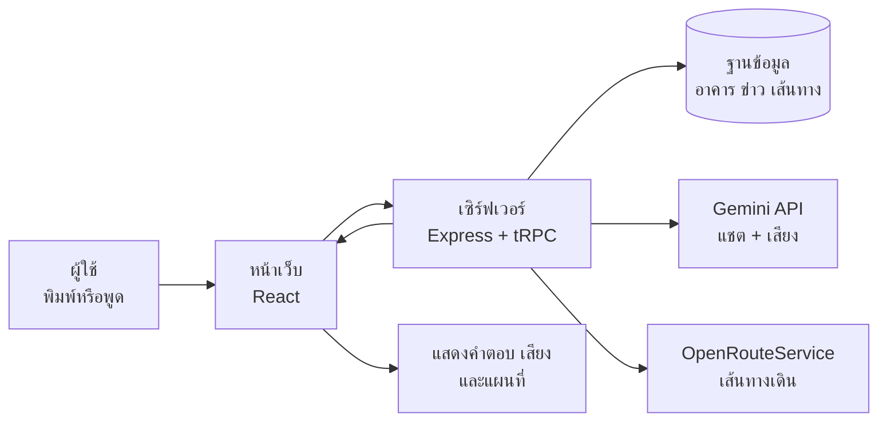

# น้องปลาทูออนทัวร์ (Nong Pla Too On Tour)

ระบบประชาสัมพันธ์อัจฉริยะของวิทยาลัยเทคนิคสมุทรสงคราม — ผู้มาติดต่อถามทางหรือถามข้อมูลวิทยาลัยกับ "น้องปลาทู" ได้ด้วยการพิมพ์หรือพูดภาษาไทย แล้วดูเส้นทางเดินไปยังอาคารบนแผนที่ได้ทันที

**ลองใช้งาน:** https://nong-pla-too.onrender.com/
(โฮสต์แบบฟรี ครั้งแรกที่เปิดอาจรอประมาณ 1 นาทีให้เซิร์ฟเวอร์ตื่น)

**รางวัล:** ชนะเลิศ เหรียญเงิน การประกวดสิ่งประดิษฐ์ของคนรุ่นใหม่ ระดับสถานศึกษา ปีการศึกษา 2569 (10 กันยายน 2569)

## ทำอะไรได้บ้าง

- **แชตบอตน้องปลาทู** — ตอบคำถามเรื่องอาคาร สาขาวิชา และข่าวของวิทยาลัย
- **พูดคุยด้วยเสียงภาษาไทย** — พูดถามได้ และน้องปลาทูตอบกลับเป็นเสียง
- **แผนที่และเส้นทางเดิน** — แสดงอาคารบนแผนที่ และวาดเส้นทางเดินไปยังอาคารที่ต้องการ
- **ข่าวประชาสัมพันธ์** — ดึงข่าวจากเว็บไซต์วิทยาลัยมาแสดงอัตโนมัติ
- **ระบบ admin** — เจ้าหน้าที่ล็อกอินเพื่อแก้ไขข้อมูลอาคาร เส้นทาง ข่าว และบัญชีผู้ใช้
- ใช้ได้ทั้งบนตู้ประชาสัมพันธ์ (Kiosk) และมือถือ

## ขั้นตอนการทำงาน



**เมื่อผู้ใช้ถามคำถาม เช่น "อาคารคอมพิวเตอร์ไปทางไหน"**

1. **รับคำถาม** — ผู้ใช้พิมพ์หรือกดไมโครโฟนพูด ถ้าเป็นเสียง เซิร์ฟเวอร์ส่งไฟล์เสียงให้ Gemini แปลงเป็นข้อความก่อน
2. **เตรียมข้อมูล** — เซิร์ฟเวอร์ดึงข้อมูลอาคาร ห้อง สาขา และข่าวล่าสุดจากฐานข้อมูล แล้วแนบไปกับคำถาม เพื่อให้ AI ตอบจากข้อมูลจริงของวิทยาลัย
3. **ให้ AI ตอบ** — ส่งคำถามพร้อมข้อมูลไปที่ Gemini ได้คำตอบเป็นข้อความภาษาไทย
4. **ตัดสินใจแสดงเส้นทาง** — ถ้าเป็นคำถามถามทาง Gemini จะเรียกเครื่องมือ `show_walking_route` พร้อมระบุอาคารปลายทาง
5. **คำนวณเส้นทาง** — เซิร์ฟเวอร์ขอเส้นทางเดินเท้าจาก OpenRouteService แล้วเก็บผลไว้ในแคช ครั้งต่อไปที่ถามเส้นทางเดิมจะตอบได้ทันที
6. **แสดงผล** — หน้าเว็บแสดงคำตอบ วาดเส้นทางบนแผนที่ และเล่นเสียงตอบที่ Gemini สังเคราะห์ให้

**งานที่ทำงานเบื้องหลังอัตโนมัติ**

- เซิร์ฟเวอร์เข้าไปอ่านหน้าข่าวของเว็บไซต์วิทยาลัย (sstc.ac.th) เป็นระยะ แล้วบันทึกข่าวใหม่ลงฐานข้อมูล
- จำกัดจำนวนคำขอเสียงต่อผู้ใช้ และแคชเสียงที่เคยสร้างแล้ว เพื่อไม่ให้โควตา API หมด
- API key ทั้งหมดเก็บไว้ฝั่งเซิร์ฟเวอร์ ไม่ส่งไปที่เบราว์เซอร์ของผู้ใช้

**ฝั่งเจ้าหน้าที่**

1. ล็อกอินที่หน้า `/admin` ด้วยชื่อผู้ใช้และรหัสผ่าน
2. แก้ไขข้อมูลอาคาร เส้นทางเดิน ข่าว หรือบัญชีเจ้าหน้าที่
3. ข้อมูลบันทึกลงฐานข้อมูล และแชตบอตใช้ข้อมูลใหม่ตอบคำถามครั้งถัดไปทันที

## เทคโนโลยีที่ใช้

| ส่วน | เทคโนโลยี |
| --- | --- |
| Frontend | React, Vite, TypeScript, Tailwind CSS, Leaflet (OpenStreetMap) |
| Backend | Node.js, Express, tRPC, TypeScript |
| ฐานข้อมูล | MySQL / TiDB ผ่าน Drizzle ORM |
| AI | Google Gemini API (แชต, แปลงเสียงเป็นข้อความ, สังเคราะห์เสียง) |
| แผนที่ | OpenRouteService (เส้นทางเดินเท้า) |
| Deploy | Render |

## โครงสร้างโค้ด

```
client/                     หน้าเว็บ (React)
  public/                   ไฟล์ที่เปิดตรงๆ ได้: รูป, ไอคอน PWA, manifest, service worker
    images/buildings/       รูปบนหมุดอาคาร
    images/departments/     โลโก้สาขาวิชา
    images/kiosk/           รูปตัวละครน้องปลาทู
  src/
    pages/
      kiosk/                หน้าตู้ Kiosk  ( / )
      mobile/               แอปมือถือ ใช้ GPS  ( /app )
      explore/              หน้าสำรวจวิทยาลัย  ( /explore )
      admin/                หน้าเจ้าหน้าที่  ( /admin/... )
    components/
      map/                  แผนที่ Leaflet, แผงนำทางทีละโค้ง, ตัวเลือกจุดบนแผนที่
      assistant/            แชตบอตน้องปลาทู + โต้ตอบด้วยเสียง
      common/               QR code, ปุ่มติดตั้งแอป, ตัวจับ error
      admin/                ส่วนประกอบของหน้า admin (นำเข้าจาก Google My Maps)
      ui/                   ปุ่ม/ฟอร์มพื้นฐาน (shadcn/ui)
    hooks/                  useCampusNavigation (นำทาง), useIdle (รีเซ็ตตู้) ฯลฯ
    lib/                    เสียง (voice.ts), ระยะทาง/GPS (directions.ts), tRPC
    config/kioskAssets.ts   ตั้งค่ารูป: ตัวละคร, โลโก้สาขา, รูปบนหมุดอาคาร
server/                     ระบบหลังบ้าน (Express + tRPC)
  routers.ts                รวม API ทั้งหมด (ชื่อเดียวกับแอปเก่า)
  db.ts                     คำสั่งฐานข้อมูล
  assistant/chat.ts         แชตบอต: ส่งคำถามให้ Gemini พร้อมข้อมูลวิทยาลัย
  assistant/voice.ts        เสียงพูด/ฟังภาษาไทย พร้อมจำกัดจำนวนคำขอและแคช
  campus/walkingRoute.ts    เส้นทางเดินนอกวิทยาลัยจาก OpenRouteService
  campus/newsScraper.ts     ดึงข่าวจากเว็บไซต์วิทยาลัย
  campus/seed.ts            ใส่ข้อมูลตั้งต้นลงฐานข้อมูล
  admin/adminRouter.ts      API สำหรับเจ้าหน้าที่ (อาคาร, ข่าว, ทางเดิน, ผู้ใช้)
  _core/                    ระบบพื้นฐาน: เซิร์ฟเวอร์, ล็อกอิน, cookie, สิทธิ์
  tests/                    ชุดทดสอบฝั่งเซิร์ฟเวอร์
shared/                     ใช้ร่วมกันทั้งสองฝั่ง
  campus.ts                 ข้อมูลอาคาร 22 จุด พิกัด ห้อง สาขา
  walkNetwork.ts            คำนวณเส้นทางเดินจริง + คำบอกทางเลี้ยว
  data/campusWalkNetwork.json  เส้นทางเดินในวิทยาลัย
  roles.ts                  สิทธิ์ admin / editor / viewer
drizzle/                    โครงสร้างตารางและ migration
scripts/                    คำสั่งช่วย: ดึงข่าว (news:sync), สร้างเส้นทางเดินจาก OSM
docs/                       เอกสารประกอบ และบันทึกการออกแบบ
```

## วิธีรันบนเครื่อง

ต้องมี Node.js 20 ขึ้นไป และ pnpm

```bash
pnpm install
cp .env.example .env   # แล้วเติมค่าของตัวเอง
pnpm dev
```

จากนั้นเปิด http://localhost:3000

ค่าหลักใน `.env`

| ตัวแปร | ใช้ทำอะไร |
| --- | --- |
| `DATABASE_URL` | ฐานข้อมูล MySQL / TiDB (เว้นว่างได้ ระบบจะใช้ข้อมูลตัวอย่าง) |
| `GEMINI_API_KEY` | แชตบอตและเสียงพูด |
| `ORS_API_KEY` | เส้นทางเดินจาก OpenRouteService (ไม่บังคับ) |
| `ADMIN_USERNAME`, `ADMIN_PASSWORD` | บัญชีหลักสำหรับเข้าหน้า `/admin` |
| `JWT_SECRET` | กุญแจเซ็น cookie ล็อกอิน |

ห้าม commit ไฟล์ `.env` ขึ้น GitHub

## ผู้พัฒนาระบบหลังบ้าน

**นิติพันธ์ ลายทอง** — นักเรียน ปวช. สาขาเทคโนโลยีธุรกิจดิจิทัล วิทยาลัยเทคนิคสมุทรสงคราม

รับผิดชอบระบบหลังบ้าน (Backend) ทั้งหมดของโครงงาน:

- ออกแบบ API ด้วย Node.js, Express, tRPC และฐานข้อมูล MySQL
- เชื่อมต่อ Gemini API สำหรับแชตบอตและเสียงพูดภาษาไทย
- เชื่อมต่อ OpenRouteService เพื่อคำนวณเส้นทางเดินบนแผนที่
- ระบบดึงข่าวจากเว็บไซต์วิทยาลัย และระบบล็อกอินเจ้าหน้าที่
